<a href="https://moutazm.com"><picture><source media="(prefers-color-scheme: dark)" srcset="assets/banner-dark.svg"><source media="(prefers-color-scheme: light)" srcset="assets/banner-light.svg"></picture></a>

  
  
  
  

<picture><source media="(prefers-color-scheme: dark)" srcset="assets/div-about-dark.svg"><source media="(prefers-color-scheme: light)" srcset="assets/div-about-light.svg">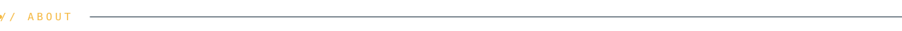</picture>

I test, debug and bring up **automotive in-vehicle networks (CAN / CAN FD)** at an ISO/IEC 17025-accredited test house in Germany.
In my own time I run a small **self-hosted infrastructure** on a Raspberry Pi and build **LLM-powered automation** on top of it.
I'm studying for an M.Sc. in Web Technologies, with a thesis on cross-lingual (Arabic / German) **retrieval-augmented generation**.

> **Where I'm heading:** AI engineering, with the discipline of embedded work behind it. Measured, secure, and built to keep running.

<picture><source media="(prefers-color-scheme: dark)" srcset="assets/div-now-dark.svg"><source media="(prefers-color-scheme: light)" srcset="assets/div-now-light.svg"></picture>

<picture><source media="(prefers-color-scheme: dark)" srcset="assets/now-dark.svg"><source media="(prefers-color-scheme: light)" srcset="assets/now-light.svg">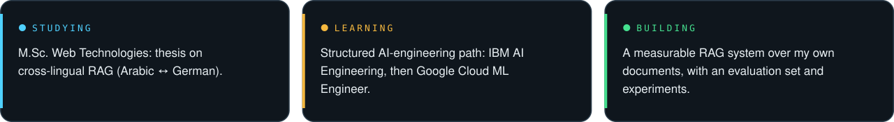</picture>

<picture><source media="(prefers-color-scheme: dark)" srcset="assets/div-homelab-dark.svg"><source media="(prefers-color-scheme: light)" srcset="assets/div-homelab-light.svg"></picture>

<a href="https://moutazm.com/projects/moutaz-home/"><picture><source media="(prefers-color-scheme: dark)" srcset="https://raw.githubusercontent.com/moutaz121493/moutaz121493/live/live-dark.svg"><source media="(prefers-color-scheme: light)" srcset="https://raw.githubusercontent.com/moutaz121493/moutaz121493/live/live-light.svg"></picture></a>

<picture><source media="(prefers-color-scheme: dark)" srcset="assets/div-selected-work-dark.svg"><source media="(prefers-color-scheme: light)" srcset="assets/div-selected-work-light.svg"></picture>

  <a href="https://github.com/moutaz121493/diag-agent"><picture><source media="(prefers-color-scheme: dark)" srcset="assets/card-diag-agent-dark.svg"><source media="(prefers-color-scheme: light)" srcset="assets/card-diag-agent-light.svg"></picture></a>
  <a href="https://moutazm.com/projects/can-tools/"><picture><source media="(prefers-color-scheme: dark)" srcset="assets/card-can-tools-dark.svg"><source media="(prefers-color-scheme: light)" srcset="assets/card-can-tools-light.svg"></picture></a>

  <a href="https://moutazm.com/projects/moutaz-home/"><picture><source media="(prefers-color-scheme: dark)" srcset="assets/card-moutaz-home-dark.svg"><source media="(prefers-color-scheme: light)" srcset="assets/card-moutaz-home-light.svg"></picture></a>
  <a href="https://moutazm.com/projects/paperless-ai/"><picture><source media="(prefers-color-scheme: dark)" srcset="assets/card-paperless-ai-dark.svg"><source media="(prefers-color-scheme: light)" srcset="assets/card-paperless-ai-light.svg"></picture></a>

  <a href="https://moutazm.com/projects/home-rag/"><picture><source media="(prefers-color-scheme: dark)" srcset="assets/card-home-rag-dark.svg"><source media="(prefers-color-scheme: light)" srcset="assets/card-home-rag-light.svg"></picture></a>
  <a href="https://github.com/moutaz121493/Moutazm.com"><picture><source media="(prefers-color-scheme: dark)" srcset="assets/card-moutazm-com-dark.svg"><source media="(prefers-color-scheme: light)" srcset="assets/card-moutazm-com-light.svg"></picture></a>

<picture><source media="(prefers-color-scheme: dark)" srcset="assets/div-toolbox-dark.svg"><source media="(prefers-color-scheme: light)" srcset="assets/div-toolbox-light.svg">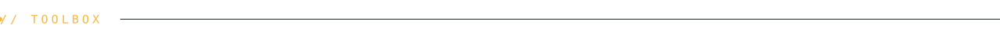</picture>

<picture><source media="(prefers-color-scheme: dark)" srcset="assets/stack-dark.svg"><source media="(prefers-color-scheme: light)" srcset="assets/stack-light.svg">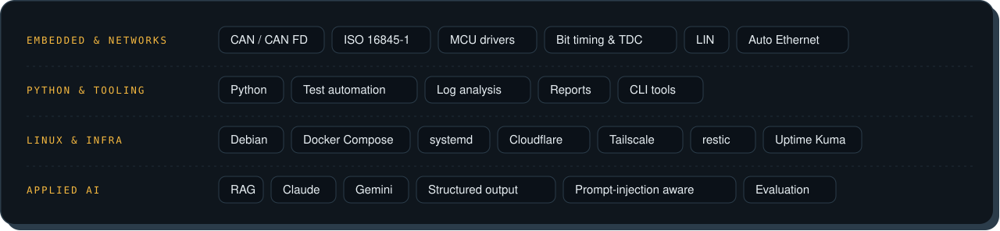</picture>

<picture><source media="(prefers-color-scheme: dark)" srcset="assets/div-journey-dark.svg"><source media="(prefers-color-scheme: light)" srcset="assets/div-journey-light.svg">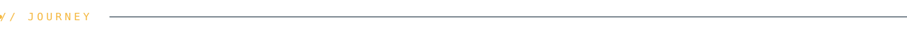</picture>

<picture><source media="(prefers-color-scheme: dark)" srcset="assets/journey-dark.svg"><source media="(prefers-color-scheme: light)" srcset="assets/journey-light.svg"></picture>

<picture><source media="(prefers-color-scheme: dark)" srcset="assets/div-contact-dark.svg"><source media="(prefers-color-scheme: light)" srcset="assets/div-contact-light.svg">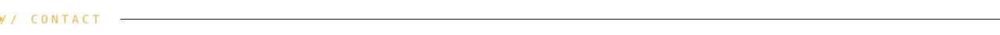</picture>

🌍 Arabic (native) · English (C1) · German (B2)  
📫 [moutazm.com](https://moutazm.com) · [LinkedIn](https://www.linkedin.com/in/moutaz-mohammad-728356347/) · moutaz@moutazm.com · open to conversations about embedded, networking and applied-AI roles in Germany.

<picture><source media="(prefers-color-scheme: dark)" srcset="assets/footer-dark.svg"><source media="(prefers-color-scheme: light)" srcset="assets/footer-light.svg"></picture>
