<a href="https://moutazm.com/3d/"><picture><source media="(max-width: 600px) and (prefers-color-scheme: dark)" srcset="assets/hero-m-dark.svg"><source media="(max-width: 600px) and (prefers-color-scheme: light)" srcset="assets/hero-m-light.svg"><source media="(prefers-color-scheme: dark)" srcset="assets/hero-dark.svg"><source media="(prefers-color-scheme: light)" srcset="assets/hero-light.svg"></picture></a>

  <a href="https://moutazm.com/3d/"><b>▶ Open the interactive 3D version</b></a>

  
  
  
  

<picture><source media="(max-width: 600px) and (prefers-color-scheme: dark)" srcset="assets/div-about-m-dark.svg"><source media="(max-width: 600px) and (prefers-color-scheme: light)" srcset="assets/div-about-m-light.svg"><source media="(prefers-color-scheme: dark)" srcset="assets/div-about-dark.svg"><source media="(prefers-color-scheme: light)" srcset="assets/div-about-light.svg"></picture>

I test, debug and bring up **automotive in-vehicle networks (CAN / CAN FD)** at an ISO/IEC 17025-accredited test house in Germany.
In my own time I run a small **self-hosted infrastructure** on a Raspberry Pi and build **LLM-powered automation** on top of it.
I'm studying for an M.Sc. in Web Technologies, with a thesis on cross-lingual (Arabic / German) **retrieval-augmented generation**.

> **Where I'm heading:** AI engineering, with the discipline of embedded work behind it. Measured, secure, and built to keep running.

<picture><source media="(max-width: 600px) and (prefers-color-scheme: dark)" srcset="assets/div-now-m-dark.svg"><source media="(max-width: 600px) and (prefers-color-scheme: light)" srcset="assets/div-now-m-light.svg"><source media="(prefers-color-scheme: dark)" srcset="assets/div-now-dark.svg"><source media="(prefers-color-scheme: light)" srcset="assets/div-now-light.svg"></picture>

<picture><source media="(max-width: 600px) and (prefers-color-scheme: dark)" srcset="assets/now3d-m-dark.svg"><source media="(max-width: 600px) and (prefers-color-scheme: light)" srcset="assets/now3d-m-light.svg"><source media="(prefers-color-scheme: dark)" srcset="assets/now3d-dark.svg"><source media="(prefers-color-scheme: light)" srcset="assets/now3d-light.svg"></picture>

<picture><source media="(max-width: 600px) and (prefers-color-scheme: dark)" srcset="assets/div-homelab-m-dark.svg"><source media="(max-width: 600px) and (prefers-color-scheme: light)" srcset="assets/div-homelab-m-light.svg"><source media="(prefers-color-scheme: dark)" srcset="assets/div-homelab-dark.svg"><source media="(prefers-color-scheme: light)" srcset="assets/div-homelab-light.svg"></picture>

<a href="https://moutazm.com/projects/moutaz-home/"><picture><source media="(max-width: 600px) and (prefers-color-scheme: dark)" srcset="assets/homelab-m-dark.svg"><source media="(max-width: 600px) and (prefers-color-scheme: light)" srcset="assets/homelab-m-light.svg"><source media="(prefers-color-scheme: dark)" srcset="assets/homelab-dark.svg"><source media="(prefers-color-scheme: light)" srcset="assets/homelab-light.svg"></picture></a>

<picture><source media="(max-width: 600px) and (prefers-color-scheme: dark)" srcset="assets/div-can-fd-m-dark.svg"><source media="(max-width: 600px) and (prefers-color-scheme: light)" srcset="assets/div-can-fd-m-light.svg"><source media="(prefers-color-scheme: dark)" srcset="assets/div-can-fd-dark.svg"><source media="(prefers-color-scheme: light)" srcset="assets/div-can-fd-light.svg">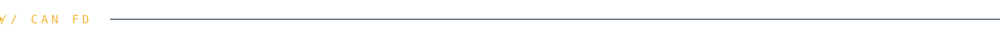</picture>

<picture><source media="(max-width: 600px) and (prefers-color-scheme: dark)" srcset="assets/canfd-m-dark.svg"><source media="(max-width: 600px) and (prefers-color-scheme: light)" srcset="assets/canfd-m-light.svg"><source media="(prefers-color-scheme: dark)" srcset="assets/canfd-dark.svg"><source media="(prefers-color-scheme: light)" srcset="assets/canfd-light.svg"></picture>

<picture><source media="(max-width: 600px) and (prefers-color-scheme: dark)" srcset="assets/div-selected-work-m-dark.svg"><source media="(max-width: 600px) and (prefers-color-scheme: light)" srcset="assets/div-selected-work-m-light.svg"><source media="(prefers-color-scheme: dark)" srcset="assets/div-selected-work-dark.svg"><source media="(prefers-color-scheme: light)" srcset="assets/div-selected-work-light.svg"></picture>

  <a href="https://github.com/moutaz121493/diag-agent"><picture><source media="(max-width: 600px) and (prefers-color-scheme: dark)" srcset="assets/card3d-diag-agent-m-dark.svg"><source media="(max-width: 600px) and (prefers-color-scheme: light)" srcset="assets/card3d-diag-agent-m-light.svg"><source media="(prefers-color-scheme: dark)" srcset="assets/card3d-diag-agent-dark.svg"><source media="(prefers-color-scheme: light)" srcset="assets/card3d-diag-agent-light.svg">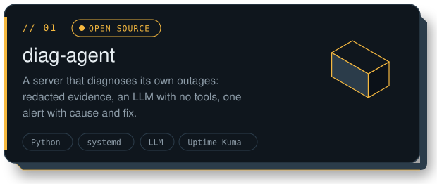</picture></a>
  <a href="https://moutazm.com/projects/can-tools/"><picture><source media="(max-width: 600px) and (prefers-color-scheme: dark)" srcset="assets/card3d-can-tools-m-dark.svg"><source media="(max-width: 600px) and (prefers-color-scheme: light)" srcset="assets/card3d-can-tools-m-light.svg"><source media="(prefers-color-scheme: dark)" srcset="assets/card3d-can-tools-dark.svg"><source media="(prefers-color-scheme: light)" srcset="assets/card3d-can-tools-light.svg">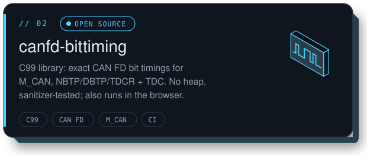</picture></a>

  <a href="https://moutazm.com/projects/moutaz-home/"><picture><source media="(max-width: 600px) and (prefers-color-scheme: dark)" srcset="assets/card3d-moutaz-home-m-dark.svg"><source media="(max-width: 600px) and (prefers-color-scheme: light)" srcset="assets/card3d-moutaz-home-m-light.svg"><source media="(prefers-color-scheme: dark)" srcset="assets/card3d-moutaz-home-dark.svg"><source media="(prefers-color-scheme: light)" srcset="assets/card3d-moutaz-home-light.svg">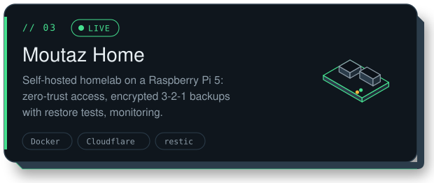</picture></a>
  <a href="https://moutazm.com/projects/paperless-ai/"><picture><source media="(max-width: 600px) and (prefers-color-scheme: dark)" srcset="assets/card3d-paperless-ai-m-dark.svg"><source media="(max-width: 600px) and (prefers-color-scheme: light)" srcset="assets/card3d-paperless-ai-m-light.svg"><source media="(prefers-color-scheme: dark)" srcset="assets/card3d-paperless-ai-dark.svg"><source media="(prefers-color-scheme: light)" srcset="assets/card3d-paperless-ai-light.svg">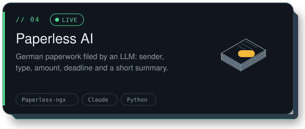</picture></a>

  <a href="https://moutazm.com/projects/home-rag/"><picture><source media="(max-width: 600px) and (prefers-color-scheme: dark)" srcset="assets/card3d-home-rag-m-dark.svg"><source media="(max-width: 600px) and (prefers-color-scheme: light)" srcset="assets/card3d-home-rag-m-light.svg"><source media="(prefers-color-scheme: dark)" srcset="assets/card3d-home-rag-dark.svg"><source media="(prefers-color-scheme: light)" srcset="assets/card3d-home-rag-light.svg">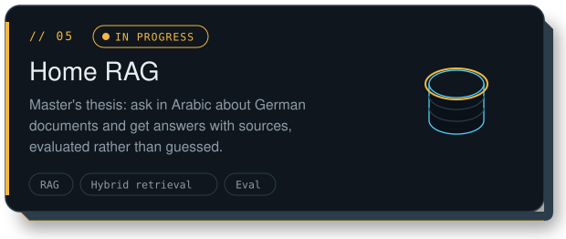</picture></a>
  <a href="https://github.com/moutaz121493/Moutazm.com"><picture><source media="(max-width: 600px) and (prefers-color-scheme: dark)" srcset="assets/card3d-moutazm-com-m-dark.svg"><source media="(max-width: 600px) and (prefers-color-scheme: light)" srcset="assets/card3d-moutazm-com-m-light.svg"><source media="(prefers-color-scheme: dark)" srcset="assets/card3d-moutazm-com-dark.svg"><source media="(prefers-color-scheme: light)" srcset="assets/card3d-moutazm-com-light.svg">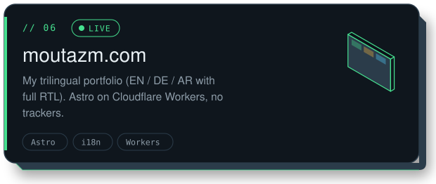</picture></a>

<picture><source media="(max-width: 600px) and (prefers-color-scheme: dark)" srcset="assets/div-thesis-m-dark.svg"><source media="(max-width: 600px) and (prefers-color-scheme: light)" srcset="assets/div-thesis-m-light.svg"><source media="(prefers-color-scheme: dark)" srcset="assets/div-thesis-dark.svg"><source media="(prefers-color-scheme: light)" srcset="assets/div-thesis-light.svg"></picture>

<picture><source media="(max-width: 600px) and (prefers-color-scheme: dark)" srcset="assets/trace-m-dark.svg"><source media="(max-width: 600px) and (prefers-color-scheme: light)" srcset="assets/trace-m-light.svg"><source media="(prefers-color-scheme: dark)" srcset="assets/trace-dark.svg"><source media="(prefers-color-scheme: light)" srcset="assets/trace-light.svg"></picture>

<picture><source media="(max-width: 600px) and (prefers-color-scheme: dark)" srcset="assets/activity-m-dark.svg"><source media="(max-width: 600px) and (prefers-color-scheme: light)" srcset="assets/activity-m-light.svg"><source media="(prefers-color-scheme: dark)" srcset="assets/activity-dark.svg"><source media="(prefers-color-scheme: light)" srcset="assets/activity-light.svg">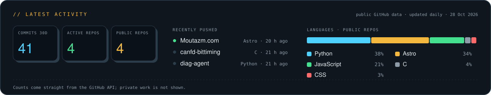</picture>

<picture><source media="(max-width: 600px) and (prefers-color-scheme: dark)" srcset="assets/div-contributions-m-dark.svg"><source media="(max-width: 600px) and (prefers-color-scheme: light)" srcset="assets/div-contributions-m-light.svg"><source media="(prefers-color-scheme: dark)" srcset="assets/div-contributions-dark.svg"><source media="(prefers-color-scheme: light)" srcset="assets/div-contributions-light.svg">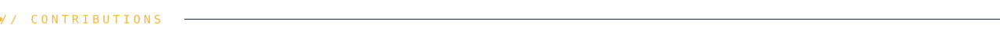</picture>

<picture><source media="(prefers-color-scheme: dark)" srcset="assets/skyline-dark.svg"><source media="(prefers-color-scheme: light)" srcset="assets/skyline-light.svg">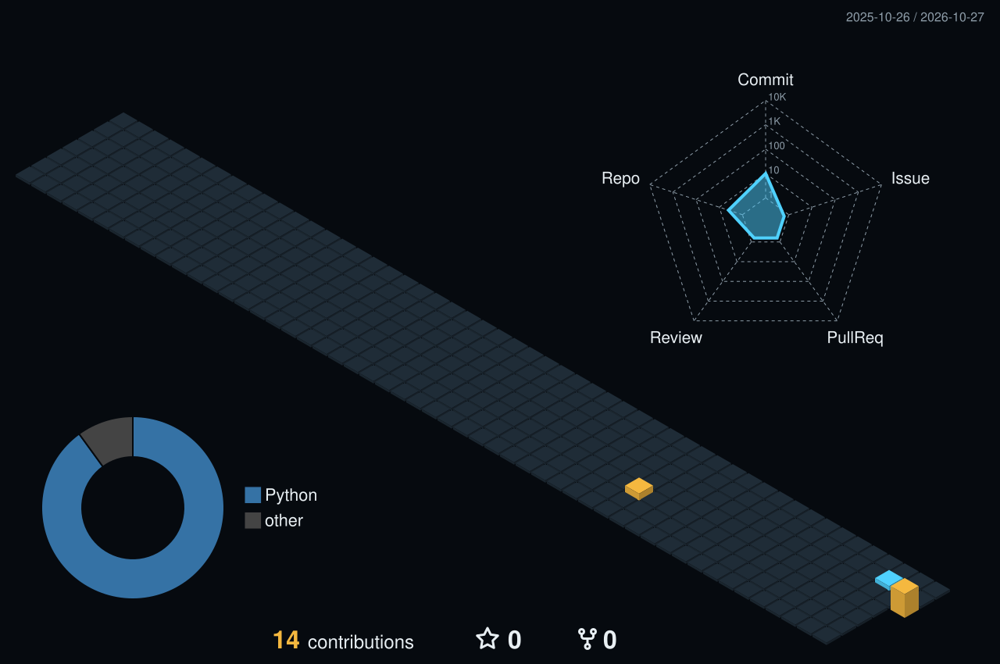</picture>

<picture><source media="(max-width: 600px) and (prefers-color-scheme: dark)" srcset="assets/div-toolbox-m-dark.svg"><source media="(max-width: 600px) and (prefers-color-scheme: light)" srcset="assets/div-toolbox-m-light.svg"><source media="(prefers-color-scheme: dark)" srcset="assets/div-toolbox-dark.svg"><source media="(prefers-color-scheme: light)" srcset="assets/div-toolbox-light.svg"></picture>

<picture><source media="(max-width: 600px) and (prefers-color-scheme: dark)" srcset="assets/stack-m-dark.svg"><source media="(max-width: 600px) and (prefers-color-scheme: light)" srcset="assets/stack-m-light.svg"><source media="(prefers-color-scheme: dark)" srcset="assets/stack-dark.svg"><source media="(prefers-color-scheme: light)" srcset="assets/stack-light.svg"></picture>

<picture><source media="(max-width: 600px) and (prefers-color-scheme: dark)" srcset="assets/div-journey-m-dark.svg"><source media="(max-width: 600px) and (prefers-color-scheme: light)" srcset="assets/div-journey-m-light.svg"><source media="(prefers-color-scheme: dark)" srcset="assets/div-journey-dark.svg"><source media="(prefers-color-scheme: light)" srcset="assets/div-journey-light.svg"></picture>

<picture><source media="(max-width: 600px) and (prefers-color-scheme: dark)" srcset="assets/journey-m-dark.svg"><source media="(max-width: 600px) and (prefers-color-scheme: light)" srcset="assets/journey-m-light.svg"><source media="(prefers-color-scheme: dark)" srcset="assets/journey-dark.svg"><source media="(prefers-color-scheme: light)" srcset="assets/journey-light.svg"></picture>

<picture><source media="(max-width: 600px) and (prefers-color-scheme: dark)" srcset="assets/div-contact-m-dark.svg"><source media="(max-width: 600px) and (prefers-color-scheme: light)" srcset="assets/div-contact-m-light.svg"><source media="(prefers-color-scheme: dark)" srcset="assets/div-contact-dark.svg"><source media="(prefers-color-scheme: light)" srcset="assets/div-contact-light.svg"></picture>

🌍 Arabic (native) · English (C1) · German (B2)  
📫 [moutazm.com](https://moutazm.com) · [LinkedIn](https://www.linkedin.com/in/moutaz-mohammad-728356347/) · moutaz@moutazm.com · open to conversations about embedded, networking and applied-AI roles in Germany.

<picture><source media="(prefers-color-scheme: dark)" srcset="assets/footer-dark.svg"><source media="(prefers-color-scheme: light)" srcset="assets/footer-light.svg"></picture>

Every image on this page is generated by the scripts in <a href="scripts">/scripts</a> (see its README); the live cards are refreshed by GitHub Actions.
